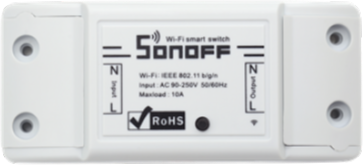
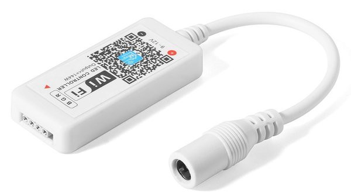
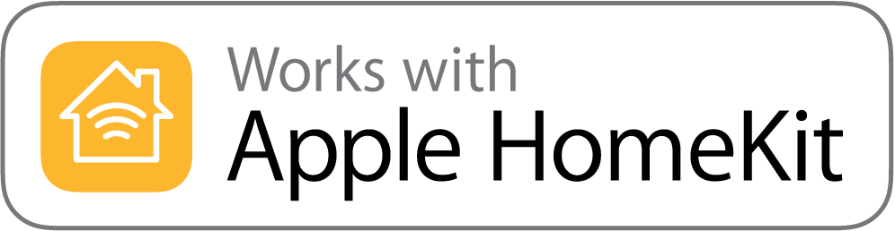
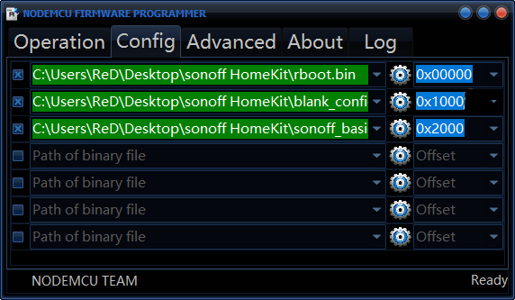
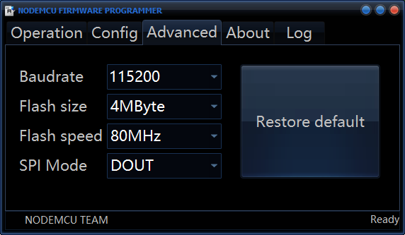
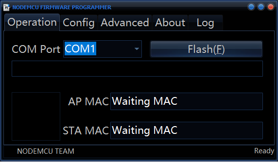

# Sonoff Homekit

Эта прошивка делает Sonoff Basic совместимым с Apple Homekit!

### Homekit работает на Sonoff! 😳

В отличии от других проектов на github, эта прошивка НЕ требует установки HomeBridge, который работает на Raspberry-Pi или по протоколу MQTT, достаточно Wi-Fi-соединения и устройства Apple!

Apple предоставила спецификации разработчикам, поэтому это стабильное и поддерживаемое программное обеспечение, и оно будет продолжать работать в течение длительного времени.

Теперь вы, наконец, можете иметь устройства HomeKit, не тратя много денег!

### Совместимые устройства
Это программное обеспечение в настоящее время протестировано на: 
<b>Sonoff Basic</b> 
<b>MagicHome led strip controller</b>

### Сейчас работаем над:

Sonoff Dual 
Sonoff 3ch 
Sonoff 4ch 
Sonoff touch 
Sonoff Basic + TH Sensor 
ESP01 Switch 
ESP8266 Switch (1ch, 2ch, ... ) 

## Инструкция

### Прошивка Sonoff
 1) Отключите ваш sonoff от линии электропитания
 2) Соедините Sonoff с последовательным адаптером по 3.3v
 3) Запустить `firmware/ESP8266Flasher.exe`
 4) Выбрать все как на скриншотах
 
 
 

### Добавляем Sonoff в приложение Дом
 1) Открываем настройки -> Wi-Fi на Вашем iPhone или iPad  
 2) Подключаемся к сети с именем: `Sonoff Switch-xxx`
 3) Вибираем из перечня Свой домашний роутер, вводим пароль и нажимаем кнопку `Join`
 4) Открываем приложение Дом
 5) Нажимаем `+` -> `Добавить аксессуар`
 6) Нажимаем  `Нет кода или не можете сканировать?`
 7) Вибираем переключатель `Sonoff-xxx Switch` 
 8) Пароль сопряжения `888-88-888`

Готово! 🎉 

## Понравился проект? Поддержите нас!

По номеру телефона:<b>+7 989 619 84 42</b>

* В примечании к переводу <b>укажите свой e-mail</b>, и я обязательно свяжусь с Вами.
* Также, можете написать "<b>Тест</b>", если хотите протестировать прошивку на этих устройствах: 
Sonoff Dual, Sonoff 3ch, Sonoff 4ch, Sonoff touch, Sonoff Basic + TH Sensor, ESP01 Switch, ESP8266 Switch (1ch, 2ch, ... ), MagicHome led strip controller

---

#### Особая благодарность:
@maximkulkin

Этот проект не существовал бы без: 
https://github.com/maximkulkin/esp-homekit 
https://github.com/maximkulkin/esp-homekit-demo 
https://github.com/maximkulkin/esp-wifi-config

